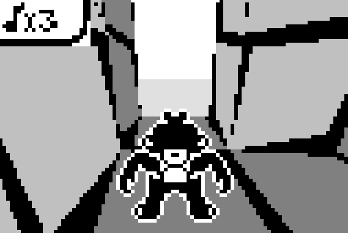

# Munkiki's Castles — PC port

Munkiki's Castles is one of the first 3D games on mobile phones: a puzzle game
published on the Nokia 3410 in 2002 for the service called Nokia Club. In the
game a little monkey must pass through several levels destroying blocks and
collecting coins, trying not to fall down while moving on a grid-based system.



**Play in the browser:** <https://seriousdev-gh.github.io/munkiki-castles-port/>
(built automatically from this repo via GitHub Pages; click the canvas once to
unlock sound).

This repository is a faithful PC port of that game. The original was written
for the Nokia 3410's M3D(O) hardware 3D engine on a 96x65 monochrome LCD; the
port reimplements the whole pipeline — fixed-point 16.16 matrices, winding
cull, z-buffer, 4-bit gray textures, 1bpp sprites — in portable software C,
and reproduces the game logic, screens, menus, saves and quirks of the
original J2ME build. The code is written clean-room from the decompiled
original (Vineflower); every class, method and field keeps its decompiled
name as a `// Java: xx` audit tag, so each line can be checked against the
original.

Built with [raylib](https://www.raylib.com) (fetched during setup; pinned to
one exact commit, see [docs/building.md](docs/building.md)) and the
[nob](https://github.com/tsoding/nob.h) build system.

## Quick start

Windows (MSVC; full steps in [docs/building.md](docs/building.md)):

```powershell
build-nob\nob.exe munkiki && build-nob\munkiki.exe   # run from the repo root
```

Linux / WSL2:

```sh
cc -O1 -o build-nob/nob nob.c && ./build-nob/nob munkiki && ./build-nob/munkiki
```

The window integer-scales the original 96x65 panel and adapts to HiDPI.

- Building (Windows, Linux, web/WASM, Android APK): [docs/building.md](docs/building.md)
- Tests, verification gates, sanitizers & save-file fuzzing: [docs/testing.md](docs/testing.md)

## Controls

The keyboard maps onto the phone keypad of the 3410:

| Key                | Phone button                                   |
|--------------------|------------------------------------------------|
| Up / W             | "2" — step forward                             |
| Down / S           | "8" — step back                                |
| Left / A, Right / D| "4", "6" — turn / sidestep                     |
| Space, F           | "5" — push block                               |
| E                  | "0" — smash block                              |
| R, /               | "*" — pause / restart level                    |
| - (minus)          | "#" — free camera (arrows look around, "#" exits) |
| 1–9                | phone digits (walk / push)                     |
| Enter              | left soft key (Select)                         |
| Backspace          | right soft key (Back)                          |
| Esc                | close window                                   |
| F8                 | toggle 1bpp device halftone (on -> off); main toggle is Options -> Dithering |
| F10                | dump the live LCD frame to `mk_live.bmp`       |

## Repository layout

- `src/` — the port: `engine.c` (level grid, monkey, block physics),
  `game.c` (screens, menus, HUD, saves), `render.c` + `m3d.c` (the software
  M3D pipeline), `main.c` (raylib shell, 25 ms clock, keyboard mapping).
- `tests/` — headless regression tests and scene capture.
- `tools/` — asset extractors that regenerate `src/assets.h` from the jar.
- `docs/` — [building](docs/building.md), [testing](docs/testing.md) and
  `formats-and-mechanics.md`: reverse-engineering notes on the level
  bitstream, M3D behavior and save-record formats.

## Legal note

Munkiki's Castles (2002) and its assets are the property of their original
authors (Kokoropa / Nokia). This project is a preservation port; the game
data embedded in `src/assets.h` was extracted from the original J2ME jar,
which is deliberately **not** committed here. If you represent the rights
holders and want anything removed, please open an issue.

## License

The port's own source code is released under the MIT license (see
[LICENSE](LICENSE)); the embedded game data is not.

## References

- Original gameplay on real hardware (high resolution): <https://www.youtube.com/watch?v=Y4Es2CarhDI>
- FreeJ2ME, an emulator with an M3D(O) reimplementation: <https://github.com/hex007/freej2me> (issue #45)
- LostMediaWiki article: <https://lostmediawiki.com/Munkiki%27s_Castles_(found_Nokia_3410_mobile_game;_2002)>
